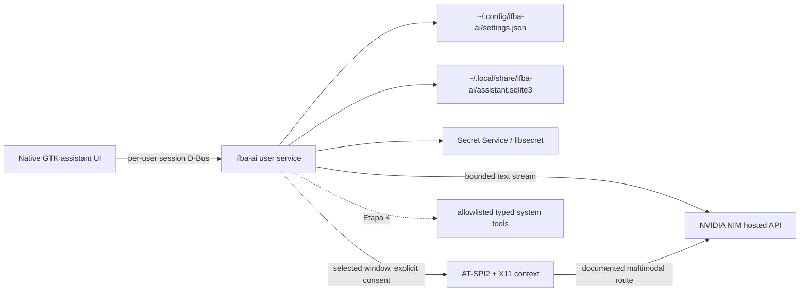

# IFBA OS architecture

## Current platform

The current built prototype remains an Ubuntu 24.04 amd64 Casper live image using XFCE4, Xfwm4, Xfdesktop, LightDM, X11, and a native panel. ISO 0.1.1 includes the assistant startup correction and kernel/initramfs build correction. The Electron files in `app/` are a design prototype and are not part of the desktop runtime.

## KDE migration decision and status

The migration is being developed in source and has not yet been incorporated into a built or tested ISO. Local branch `legacy/xfce4` points to the preserved `development` commit `4c09ec5`, and work remains on `development`. The old builder is retained as `scripts/build-iso-xfce4-legacy-container.sh`; `scripts/build-iso-container.sh` and the host wrapper target a separate Ubuntu 26.04 Plasma rootfs/cache.

The selected base is Ubuntu 26.04 LTS amd64, using only the official `resolute` archives. Official package metadata, successful debootstrap resolution, and a clean apt dependency simulation confirm Plasma 6.6, Qt 6.10, KDE Frameworks 6.24, KWin 6.6, SDDM 0.21, and both Wayland and X11 sessions are available. The live package candidates observed in the archive were Plasma 6.6.7 and Qt 6.10.2; exact versions must be captured from the resulting root filesystem. Kubuntu 26.04 provides the relevant LTS reference stack. Avoid mixing Ubuntu series or using PPAs for Plasma.

For the migration, retain the independent Python/GTK IFBA AI client and D-Bus backend, per-user state and Secret Service credential storage, Mozilla-signed Firefox DEB, and SUAP/AVA ordinary HTTPS launchers where compatible. The assistant's desktop-settings tool now selects a fixed allowlist for KDE or XFCE based on the active session; it does not execute model-provided commands. The Electron files remain a prototype. Product version `0.2.0` is assigned to this feature-set migration and must be committed before generating the ISO. No Plasma release artifact has yet been built or assigned a build ID.

The current migration build inputs define an `IFBA OS Dark` KDE color scheme and a Plasma global-theme package with a first-run, centered floating lower panel, Kickoff launcher, task manager, system tray, clock, and one virtual desktop. The first-run setup applies this layout and the supplied wallpaper once so later user changes are not overwritten at every login. SDDM is configured to start the live `ubuntu` account in the X11 `plasma.desktop` session on UTM; Wayland package support is included, but Wayland runtime compatibility is still unverified. This remains a prototype, not a fully themed production desktop.

## XFCE defaults and precedence

- The live account's active Xfconf channel files are under `/home/ubuntu/.config/xfce4/xfconf/xfce-perchannel-xml/`; these per-user values take precedence over system defaults in `/etc/xdg/xfce4/xfconf/xfce-perchannel-xml/`.
- `/etc/skel/.config/xfce4/xfconf/xfce-perchannel-xml/` seeds accounts created after the defaults are installed; it does not change existing accounts. The XFCE panel profile default is also written to `/etc/xdg/xfce4/panel/default.xml`.
- The ISO build must keep the packaged channel, the live user's channel, XDG system defaults, the panel profile, and the skeleton copies in sync. Changing only `/etc/skel` or only `default.xml` cannot override an existing user's Xfconf channel.
- The shipped panel configuration previously defined both `panel-1` and `panel-2`; `panel-1` was the lower launcher/task/status bar and `panel-2` was the extra greeting/date bar. It also included the workspace pager, while Xfwm4 set `workspace_count` to four. These declarations explain the extra bar and workspaces in a fresh profile. The default now keeps only panel 1 and one workspace.
- Session auto-save is disabled in the system and skeleton XFCE session channels to prevent a later logout from re-saving a removed panel. No saved-session files are deleted automatically; the current UTM guest has not reached XFCE, so there is no evidence yet to justify altering an existing user's saved session.
- The installed `ifba-os-fix-xfce-panel` tool has separate user-session and system-default modes. Session mode refuses root and verifies that panel 1 is the lower panel before removing extras. System-default mode changes only `/etc/xdg` and `/etc/skel`, using `pkexec` when needed; it does not apply Xfconf operations through a root D-Bus session.

## Visual scope and limits

The current desktop deliberately retains the upstream Yaru Dark GTK/Xfwm theme and Yaru icon set for stability. Inter, the supplied wallpaper, a dark graphite panel, green interaction states, and Xfwm4's compositor provide the IFBA OS layer. This is why some GTK2, GTK4/libadwaita, and non-GTK applications can still look like Ubuntu or use their own styling; the global override is GTK3-focused and there is no separate IFBA GTK2/Xfwm theme package yet. Do not claim that all dialogs and applications have been visually verified until XFCE starts in the target ISO.

The IFBA AI settings stack now defaults to no transitions. XFCE-wide reduced-motion preference and actual motion behavior across panel/window manager/apps remain unverified.

## Assistant components

### Local contracts

- The GTK process and daemon use the current user's D-Bus session bus. D-Bus name: `org.ifba.OS.AI`; object: `/org/ifba/OS/AI`; interface: `org.ifba.OS.AI1`.
- Configuration/conversation methods: `GetStatus`, `GetSettings`, `SaveSettings`, `StoreApiKey`, `DeleteApiKey`, `CreateConversation`, `ListConversations`, `ListMessages`, and `AddMessage`. Stage 2 adds `StartGeneration`, `CancelGeneration`, and the `MessageDelta`, `GenerationFinished`, and `GenerationFailed` signals. Stage 3 adds local window-list/capture/control-bound methods, `StartVisualGeneration`, and `VisualGuide`.
- The daemon runs as the logged-in user, under a systemd user unit. It has no root authority, package installer, arbitrary shell interface, or screenshot access.
- Per-user settings are validated JSON under XDG config. Conversations/messages/memory use a schema-versioned SQLite database under XDG data. Credentials are exclusively held by the Secret Service keyring.
- The AI feature is optional. If `secret-tool` or the user's keyring is unavailable or locked, key operations fail closed and UI explains the state.
- Stage 2 submits only a bounded recent text context to NVIDIA NIM. The per-user daemon owns the key retrieval, request, persistence, streaming, and cancellation path; GTK never receives the API key back from the service.
- Stage 3 uses explicit local window selection and capture consent. Screenshots are transient in memory; only a documented multimodal model can receive them. A target ID must match AT-SPI2 and local code reads its bounds; no model-supplied coordinates, clicks, or typing are allowed.

## Session identity and current limitation

The existing ISO is live-only and currently auto-logs into one `ubuntu` account with no password. That is suitable only for an isolated disposable demo; it does not isolate students and must not be used for real API keys or private academic data. The current repository has no installer, student account provisioning service, or authorized IFBA identity-verification API. A matrícula cannot be treated as verified identity merely because it is entered as a local username. Implementing a secure login needs an installation/user-provisioning design and institutional authorization.

Do not ship one shared `12345` password. A unique, administrator-provisioned one-time credential with mandatory change is a safer future option, but account creation and recovery policy must be designed before implementation.

## Stage boundaries

- **Etapa 1:** per-user state, keyring integration, GTK configuration, D-Bus service, private SQLite foundation.
- **Etapa 2:** NVIDIA chat/completions, streaming, GTK conversation workflow, request cancellation and error policy.
- **Etapa 3:** active-window/AT-SPI context and explicitly consented visual assistance.
- **Etapa 4:** student-controlled learning memory and typed, confirmed system actions.
- **Etapa 5:** final XFCE/LightDM/Plymouth/ISO integration, VM boot cycles, security/performance review.

See [`IMPLEMENTATION-QUEUE.md`](IMPLEMENTATION-QUEUE.md) for order and status.

## Stage 4 implementation

The existing per-user SQLite store is schema version 2. It preserves version 1 data and adds a bounded extractive conversation summary plus indexes. Context sent to NVIDIA is restricted by user-configurable message and character ceilings; the assistant does not send the full stored transcript. Long-term memories remain opt-in and are manually added or corrected. Retrieval is local lexical matching, with no embedding service or additional database.

The existing per-user D-Bus service exposes typed methods for app launch, HTTP(S) URL opening, basic system details, and a fixed settings allowlist selected for KDE or XFCE. File listing/search/creation runs in the GTK client because the daemon is sandboxed with read-only access to home directories. The GTK tool panel grants a folder for the current UI session. New file creation is limited to that folder's immediate children, uses exclusive creation and mode `0600`, never overwrites, and requires a one-use confirmation token that expires after 120 seconds. The AI request path has no system-tool calling capability.
