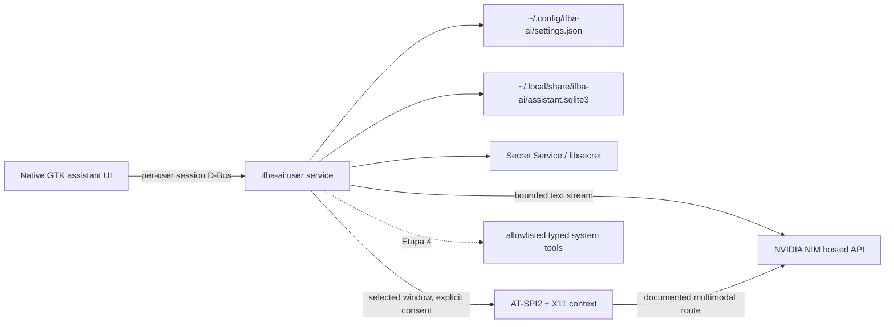

# IFBA OS architecture

## Current platform

The active prototype uses Ubuntu 26.04 and KDE Plasma 6 with shared build inputs for AMD64 and ARM64. The local v0.3.3 artifacts form a structurally verified pair from source commit `fedfa208f47a9ee54d4690a64d410c6af287cb45`; boot and runtime remain unvalidated. The current source has since advanced beyond that artifact commit. The former Ubuntu 24.04/XFCE4 implementation remains historical. Architecture support requires separate build and real boot evidence.

## KDE migration decision and status

The current build uses Ubuntu 26.04 LTS/Plasma 6.6. Local branch `legacy/xfce4` points to the preserved `development` commit `4c09ec5`, and active work remains on `development`. The old builder is retained as `scripts/build-iso-xfce4-legacy-container.sh`; `scripts/build-iso-container.sh` and its host wrapper now share the desktop configuration while selecting architecture-specific rootfs, kernel, archive, bootloader, cache, and output metadata.

The shared target is Ubuntu 26.04 LTS (`resolute`), using official architecture-specific Ubuntu archives: `archive.ubuntu.com` for amd64 and `ports.ubuntu.com/ubuntu-ports` for arm64. The documented v0.3.3 pair resolves Plasma 6.6, Qt 6.10, KDE Frameworks 6.24, KWin 6.6, and SDDM 0.21 in the AMD64 rootfs; each architecture has its own build metadata. These are package versions from a point-in-time build, not a locked package snapshot. Firefox comes from the Mozilla signed apt repository; the build checks the repository signing-key fingerprint before use.

For both architectures, the image includes the Python/GTK IFBA AI client and D-Bus backend, per-user state and Secret Service storage, Mozilla-signed Firefox DEB, and SUAP/AVA public HTTPS launchers. The application source and desktop assets are architecture-independent; apt supplies native Python/GTK, browser, kernel, graphics and firmware packages. The assistant's settings tool selects a fixed allowlist and local tools do not execute model-supplied shell commands. The D-Bus daemon starts on demand rather than at every user login. The v0.3.3 images have not booted in a current guest test.

The Live rootfs contains `/etc/ifba-os/live-demo`. In that mode the AI service does not create the conversation database, reports the assistant unavailable, and rejects API-key storage, conversation/memory writes, screenshot capture, export, and model generation. The GTK UI also disables its AI data, visual, chat, and local-tool controls. Calamares removes the marker in the target chroot; the installed account is then created by Calamares with autologin disabled. This prevents accidental use of IFBA AI for personal data in the Live demo, but is not isolation from a user with the shared Live account's administrative privileges. Files used by other desktop applications remain shared while the Live session is unlocked. These behaviors have automated source tests but need guest validation.

The Plasma package defines the `IFBA OS Dark` color scheme and a first-run panel layout; ongoing work changes its Plasma widget style and full-width floating geometry to match the desktop identity observed in UTM. The first-run setup applies layout and supplied wallpaper once so later user changes are not overwritten each login. SDDM currently autologs the shared live `ubuntu` account into `plasmax11.desktop`; Wayland runtime compatibility is unverified. The initial 0.2.0 image selected the Wayland session name while configured for X11; version 0.2.1 corrected that and visibly reached the desktop. This remains a prototype, not a fully themed production desktop.

KWin window frames are provided by the packaged Aurorae engine and the project-owned SVG theme in `packaging/plasma/window-decoration/IFBA-Window/`. The global-theme defaults select this theme and place native minimize, maximize/restore, and close controls at the right. It uses separate active/inactive and maximized frame assets, with 34 px titlebar geometry and an IFBA green maximize state. Aurorae decorates server-side windows; applications with client-side decorations retain control of their titlebar. The user-invoked `ifba-visual-profile` command changes only native KWin blur settings; the balanced default for new profiles and the light/advanced choices are documented in `WINDOW-GLASS.md`. Reduced-motion and animation preferences are not changed by the profile tool. SVG/configuration and package selection have static regression coverage, while runtime appearance and controls still require guest testing.

## Multiarchitecture build model

`scripts/build-iso.sh --both` invokes one common Plasma recipe twice from a clean, fixed source commit and shared product version. It varies Docker platform, debootstrap architecture, archive mirror, native kernel packages, GRUB EFI packages, isolated rootfs/cache, ISO volume label and architecture-specific build ID/manifest. It verifies the fixed HEAD before each architecture and refuses to start from dirty source. The publisher verifies SHA-256/size and stores each ISO under `output/versions/vX.Y.Z/{amd64,arm64}/`; `output/latest/` symlinks avoid large duplicates and `release-status.json` distinguishes a matched pair from mixed historical latest artifacts. A successful container build and ISO structure inspection do not establish UTM guest boot; each architecture needs its own VM runtime evidence.

## XFCE defaults and precedence

- The live account's active Xfconf channel files are under `/home/ubuntu/.config/xfce4/xfconf/xfce-perchannel-xml/`; these per-user values take precedence over system defaults in `/etc/xdg/xfce4/xfconf/xfce-perchannel-xml/`.
- `/etc/skel/.config/xfce4/xfconf/xfce-perchannel-xml/` seeds accounts created after the defaults are installed; it does not change existing accounts. The XFCE panel profile default is also written to `/etc/xdg/xfce4/panel/default.xml`.
- The ISO build must keep the packaged channel, the live user's channel, XDG system defaults, the panel profile, and the skeleton copies in sync. Changing only `/etc/skel` or only `default.xml` cannot override an existing user's Xfconf channel.
- The shipped panel configuration previously defined both `panel-1` and `panel-2`; `panel-1` was the lower launcher/task/status bar and `panel-2` was the extra greeting/date bar. It also included the workspace pager, while Xfwm4 set `workspace_count` to four. These declarations explain the extra bar and workspaces in a fresh profile. The default now keeps only panel 1 and one workspace.
- Session auto-save is disabled in the system and skeleton XFCE session channels to prevent a later logout from re-saving a removed panel. No saved-session files are deleted automatically; the current UTM guest has not reached XFCE, so there is no evidence yet to justify altering an existing user's saved session.
- The installed `ifba-os-fix-xfce-panel` tool has separate user-session and system-default modes. Session mode refuses root and verifies that panel 1 is the lower panel before removing extras. System-default mode changes only `/etc/xdg` and `/etc/skel`, using `pkexec` when needed; it does not apply Xfconf operations through a root D-Bus session.

## Visual scope and limits

The current desktop deliberately retains the upstream Yaru Dark GTK/Xfwm theme and Yaru icon set for stability. Inter, the supplied wallpaper, a dark graphite panel, green interaction states, and Xfwm4's compositor provide the IFBA OS layer. This is why some GTK2, GTK4/libadwaita, and non-GTK applications can still look like Ubuntu or use their own styling; the global override is GTK3-focused and there is no separate IFBA GTK2/Xfwm theme package yet. Do not claim that all dialogs and applications have been visually verified until XFCE starts in the target ISO.

The IFBA AI settings stack now defaults to no transitions. XFCE-wide reduced-motion preference and actual motion behavior across panel/window manager/apps remain unverified.

## Assistant components

### Local contracts

- The GTK process and daemon use the current user's D-Bus session bus. D-Bus name: `org.ifba.OS.AI`; object: `/org/ifba/OS/AI`; interface: `org.ifba.OS.AI1`.
- Configuration/conversation methods: `GetStatus`, `GetSettings`, `SaveSettings`, `StoreApiKey`, `DeleteApiKey`, `CreateConversation`, `ListConversations`, `ListMessages`, and `AddMessage`. Stage 2 adds `StartGeneration`, `CancelGeneration`, and the `MessageDelta`, `GenerationFinished`, and `GenerationFailed` signals. Stage 3 adds local window-list/capture/control-bound methods, `StartVisualGeneration`, and `VisualGuide`.
- The daemon runs as the logged-in user, under a systemd user unit activated on demand by the session D-Bus service when IFBA AI is opened. It is not enabled in `default.target`, so sessions that do not use the assistant do not keep it running. It has no root authority, package installer, arbitrary shell interface, or screenshot access.
- Per-user settings are validated JSON under XDG config. Conversations/messages/memory use a schema-versioned SQLite database under XDG data. Credentials are exclusively held by the Secret Service keyring.
- The AI feature is optional. If `secret-tool` or the user's keyring is unavailable or locked, key operations fail closed and UI explains the state.
- Stage 2 submits only a bounded recent text context to NVIDIA NIM. The per-user daemon owns the key retrieval, request, persistence, streaming, and cancellation path; GTK never receives the API key back from the service.
- Stage 3 uses explicit local window selection and capture consent. Screenshots are transient in memory; only a documented multimodal model can receive them. A target ID must match AT-SPI2 and local code reads its bounds; no model-supplied coordinates, clicks, or typing are allowed.

## Session identity and current limitation

The existing ISO is live-only and currently auto-logs into one `ubuntu` account with no password. That is suitable only for an isolated disposable demo; it does not isolate students and must not be used for real API keys or private academic data. The current repository has no installer, student account provisioning service, or authorized IFBA identity-verification API. A matrícula cannot be treated as verified identity merely because it is entered as a local username. Implementing a secure login needs an installation/user-provisioning design and institutional authorization.

Do not ship one shared `12345` password. A unique, administrator-provisioned one-time credential with mandatory change is a safer future option, but account creation and recovery policy must be designed before implementation.

## Stage boundaries

- **Etapa 1:** per-user state, keyring integration, GTK configuration, D-Bus service, private SQLite foundation.
- **Etapa 2:** NVIDIA chat/completions, streaming, GTK conversation workflow, request cancellation and error policy.
- **Etapa 3:** active-window/AT-SPI context and explicitly consented visual assistance.
- **Etapa 4:** student-controlled learning memory and typed, confirmed system actions.
- **Etapa 5:** final XFCE/LightDM/Plymouth/ISO integration, VM boot cycles, security/performance review.

See [`IMPLEMENTATION-QUEUE.md`](IMPLEMENTATION-QUEUE.md) for order and status.

## Stage 4 implementation

The existing per-user SQLite store is schema version 2. It preserves version 1 data and adds a bounded extractive conversation summary plus indexes. Context sent to NVIDIA is restricted by user-configurable message and character ceilings; the assistant does not send the full stored transcript. Long-term memories remain opt-in and are manually added or corrected. Retrieval is local lexical matching, with no embedding service or additional database.

The existing per-user D-Bus service exposes typed methods for app launch, HTTP(S) URL opening, basic system details, and a fixed settings allowlist selected for KDE or XFCE. File listing/search/creation runs in the GTK client because the daemon is sandboxed with read-only access to home directories. The GTK tool panel grants a folder for the current UI session. New file creation is limited to that folder's immediate children, uses exclusive creation and mode `0600`, never overwrites, and requires a one-use confirmation token that expires after 120 seconds. The AI request path has no system-tool calling capability.
