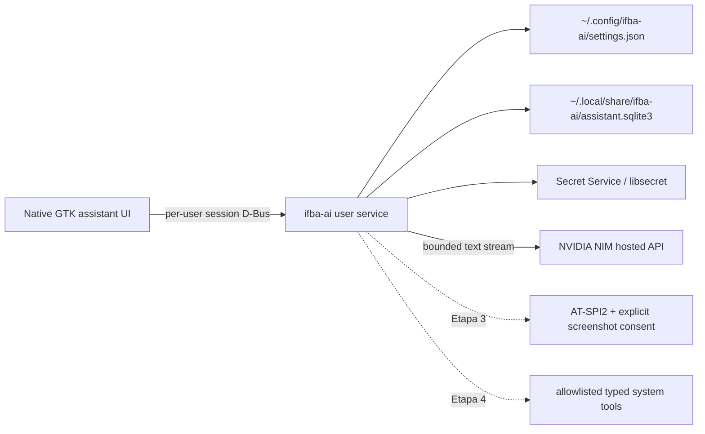

# IFBA OS architecture

## Current platform

The prototype is an Ubuntu 24.04 amd64 Casper live image using XFCE4, Xfwm4, Xfdesktop, LightDM, X11, and a native panel. The Electron files in `app/` are a design prototype and are not part of the desktop runtime.

## Assistant components

### Local contracts

- The GTK process and daemon use the current user's D-Bus session bus. D-Bus name: `org.ifba.OS.AI`; object: `/org/ifba/OS/AI`; interface: `org.ifba.OS.AI1`.
- Configuration/conversation methods: `GetStatus`, `GetSettings`, `SaveSettings`, `StoreApiKey`, `DeleteApiKey`, `CreateConversation`, `ListConversations`, `ListMessages`, and `AddMessage`. Stage 2 adds `StartGeneration`, `CancelGeneration`, and the `MessageDelta`, `GenerationFinished`, and `GenerationFailed` signals.
- The daemon runs as the logged-in user, under a systemd user unit. It has no root authority, package installer, arbitrary shell interface, or screenshot access.
- Per-user settings are validated JSON under XDG config. Conversations/messages/memory use a schema-versioned SQLite database under XDG data. Credentials are exclusively held by the Secret Service keyring.
- The AI feature is optional. If `secret-tool` or the user's keyring is unavailable or locked, key operations fail closed and UI explains the state.
- Stage 2 submits only a bounded recent text context to NVIDIA NIM. The per-user daemon owns the key retrieval, request, persistence, streaming, and cancellation path; GTK never receives the API key back from the service.

## Session identity and current limitation

The existing ISO is live-only and currently auto-logs into one `ubuntu` account with no password. That is suitable only for an isolated disposable demo; it does not isolate students and must not be used for real API keys or private academic data. The current repository has no installer, student account provisioning service, or authorized IFBA identity-verification API. A matrícula cannot be treated as verified identity merely because it is entered as a local username. Implementing a secure login needs an installation/user-provisioning design and institutional authorization.

Do not ship one shared `12345` password. A unique, administrator-provisioned one-time credential with mandatory change is a safer future option, but account creation and recovery policy must be designed before implementation.

## Stage boundaries

- **Etapa 1:** per-user state, keyring integration, GTK configuration, D-Bus service, private SQLite foundation.
- **Etapa 2:** NVIDIA chat/completions, streaming, GTK conversation workflow, request cancellation and error policy.
- **Etapa 3:** active-window/AT-SPI context and explicitly consented visual assistance.
- **Etapa 4:** student-controlled learning memory and typed, confirmed system actions.
- **Etapa 5:** final XFCE/LightDM/Plymouth/ISO integration, VM boot cycles, security/performance review.

See [`IMPLEMENTATION-QUEUE.md`](IMPLEMENTATION-QUEUE.md) for order and status.
